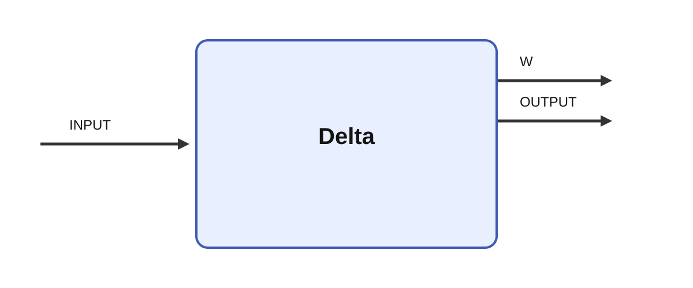

# Delta

## Description

`Delta` implements the well known delta rule for associative learning, also known as the Widrow-Hoff learning rule.
It learns a weighted response from a conditioned stimulus `CS` toward an unconditioned stimulus `US`.

On each tick, the module computes:

`CR = dot(CS, w)`

and updates the internal weights using the prediction error:

`delta = alpha * (sum(US) - CR)`

When `delta > 0`, the weights are increased in proportion to the active elements in `CS`.
When the response exceeds the US, the weights are left unchanged by default, so the model only acquires. With `extinction` above 0 they are instead decreased by `extinction * (sum(US) - CR)` in proportion to the active elements in `CS`, so a CS that is no longer followed by the US gradually loses its response.
With `trials="yes"`, learning counts events instead of ticks. A CS presentation lasts from the first tick with an active `CS` until it has been absent for `gap` seconds, so a missed detection does not split it. Each onset of the US during a presentation, after the US has been absent for `gap` seconds, moves the response `alpha` of the way to `sum(US)`, and a presentation that ends without any US moves it `extinction` of the way to 0. For a single binary CS, `n` pairings give `1 - (1 - alpha)^n`, and each presentation without the US multiplies the response by `1 - extinction`, however long the stimuli last. `CR` is held through the gaps of a presentation.

The learned weights are stored in the persistent private state matrix `WEIGHTS`, so they can be saved and restored with Ikaros state files.

If `inverse="yes"`, the output is reported as `max(0, CR - sum(US))`, which can be used to model a simple inhibitory cerebellar-style response.

## Parameters

| Name | Description | Type | Default |
| --- | --- | --- | --- |
| alpha | Learning rate | float | 0.1 |
| extinction | Learning rate when CR exceeds US; 0 keeps acquisition only | float | 0 |
| trials | Learn once per US onset and once per CS presentation instead of on every tick | bool | no |
| gap | With `trials`, seconds the CS or US must be absent before it counts as ended | float | 0.5 |
| inverse | Report inhibitory output `max(0, CR-US)` instead of `CR` | bool | no |

## Inputs

| Name | Description | Optional |
| --- | --- | --- |
| CS | The conditioned stimulus input | yes |
| US | The unconditioned stimulus input | yes |

## Outputs

| Name | Description |
| --- | --- |
| CR | The conditioned response |

## State

| Name | Type | Persistent | Description |
| --- | --- | --- | --- |
| WEIGHTS | matrix | yes | Learned association weights, shaped from `CS.size` |
